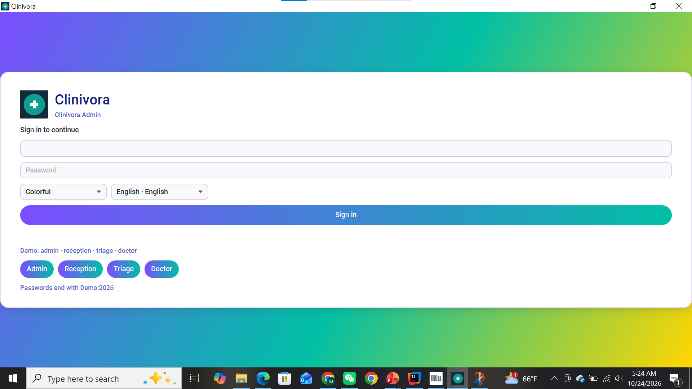
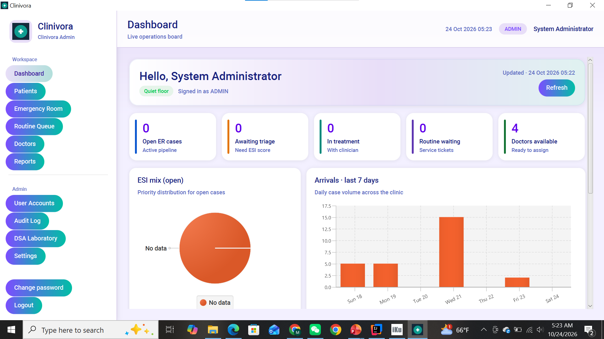
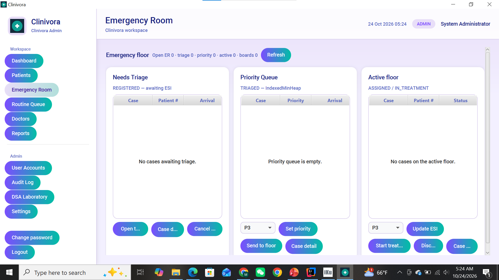
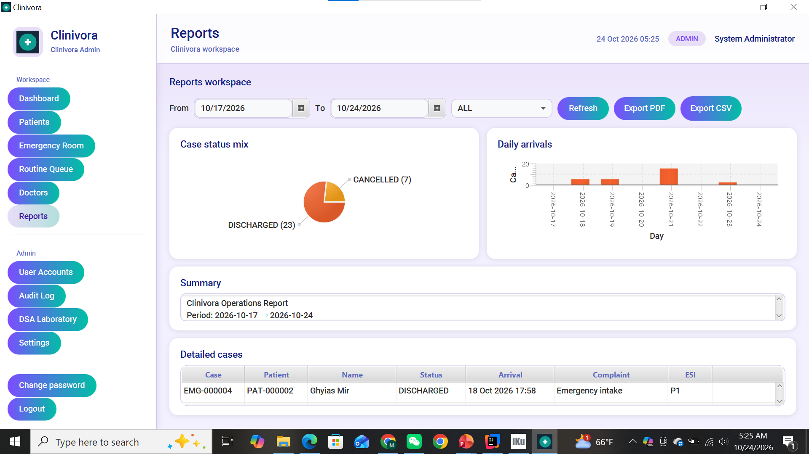

# Clinivora

Desktop emergency and clinic queue management system built with Java 21, JavaFX 21, FXML/CSS, SQLite, OpenPDF, and Maven.

Package root: `com.Clinivora`  
Database file: `data/Clinivora.db`

For features, technologies, permissions, and setup, see [PROJECT_OVERVIEW.md](PROJECT_OVERVIEW.md).

## Prerequisites

- JDK 21 (Eclipse Adoptium Temurin 21 recommended)
- Apache Maven 3.9+

```powershell
$env:JAVA_HOME = "C:\Program Files\Eclipse Adoptium\jdk-21.0.12.101-hotspot"
$env:Path = "$env:JAVA_HOME\bin;C:\Tools\apache-maven-3.9.6\bin;" + $env:Path
```

## Run

```powershell
mvn clean test
mvn javafx:run
```

## Screenshots

### Login


### Dashboard


### Emergency Room


### Reports


## UI

Clinivora uses a Google Admin / Material 3 portal skin with selectable themes:

- Roboto fonts (`src/main/resources/fonts/`)
- Themes: Light (default), Dark, Pink, Colorful
- Languages: English, Urdu (RTL), Chinese
- Preferences persist in `data/clinivora-settings.properties`
- Change theme or language on Login or in Settings (all roles)

## Demo credentials

| Username   | Password            | Role       |
|------------|---------------------|------------|
| admin      | AdminDemo!2026      | ADMIN      |
| reception  | ReceptionDemo!2026  | RECEPTION  |
| triage     | TriageDemo!2026     | TRIAGE     |
| doctor     | DoctorDemo!2026     | DOCTOR     |

Demo users are seeded on startup. Existing databases are migrated without wiping data.

## New user password and username rules

When creating users in User Accounts:

- Username: 3–40 characters; letters, numbers, `.` `_` `-` only; stored lowercase
- Password: at least 8 characters with upper, lower, digit, and special character. Example: `NurseDemo!2026`
- Role: required (defaults to RECEPTION in the form)

## Reports

ADMIN Reports is a full workspace:

- Date range and status filter
- Pie chart (case status mix) and bar chart (daily arrivals)
- Detailed case table (patient, arrival, complaint, ESI)
- Narrative summary
- Export PDF (OpenPDF) and Export CSV (UTF-8)

## Screens

- Login (theme and language selectors), Main shell, Dashboard, Settings
- Patients, Patient profile, Emergency Room, Case detail
- Routine Queue, Doctors, Reports, User Accounts, Audit Log, DSA Laboratory
- Change Password (all roles)

## Who can edit or delete

| Action | ADMIN | TRIAGE | RECEPTION | DOCTOR |
|--------|:-----:|:------:|:---------:|:------:|
| Register patient | ✓ | | ✓ | |
| Edit patient demographics | ✓ | ✓ | ✓ | |
| Soft-delete patient | ✓ | ✓ | | |
| Restore patient | ✓ | | | |
| Edit case chief complaint | ✓ | ✓ | | |
| Add clinical notes | ✓ | ✓ | | ✓ |
| Soft-deactivate doctor | ✓ | | | |
| Manage user accounts | ✓ | | | |
| View audit log / reports | ✓ | | | |
| Change own password | ✓ | ✓ | ✓ | ✓ |

## Documentation

- [Architecture](docs/architecture.md)
- [Acceptance checklist](docs/acceptance-checklist.md)
- [DSA reference](docs/dsa-reference.md)
