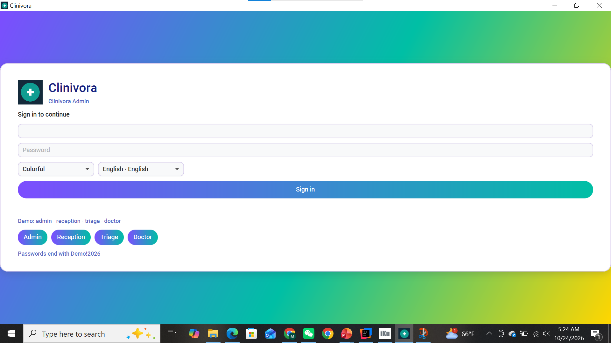
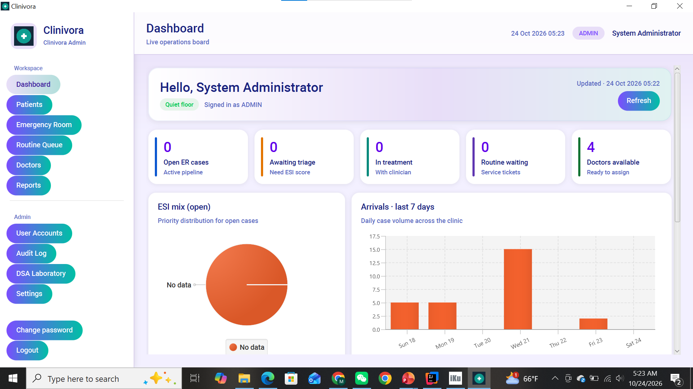
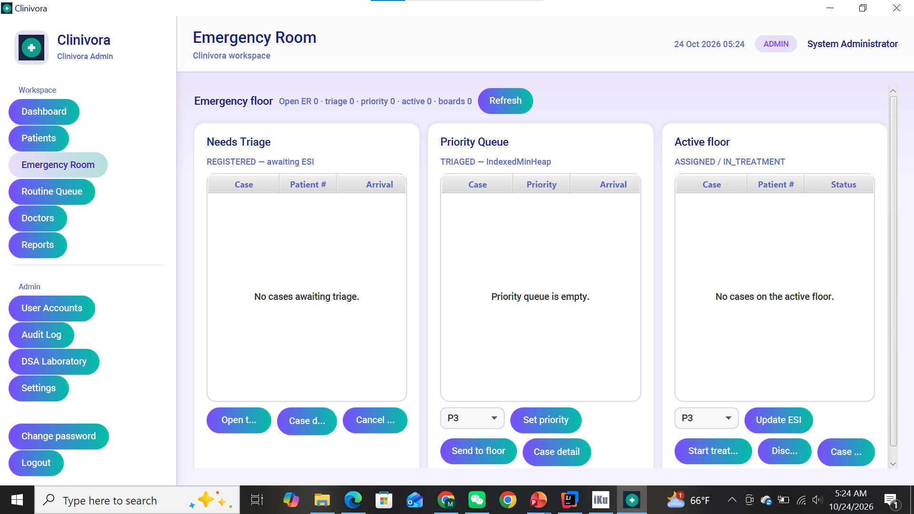
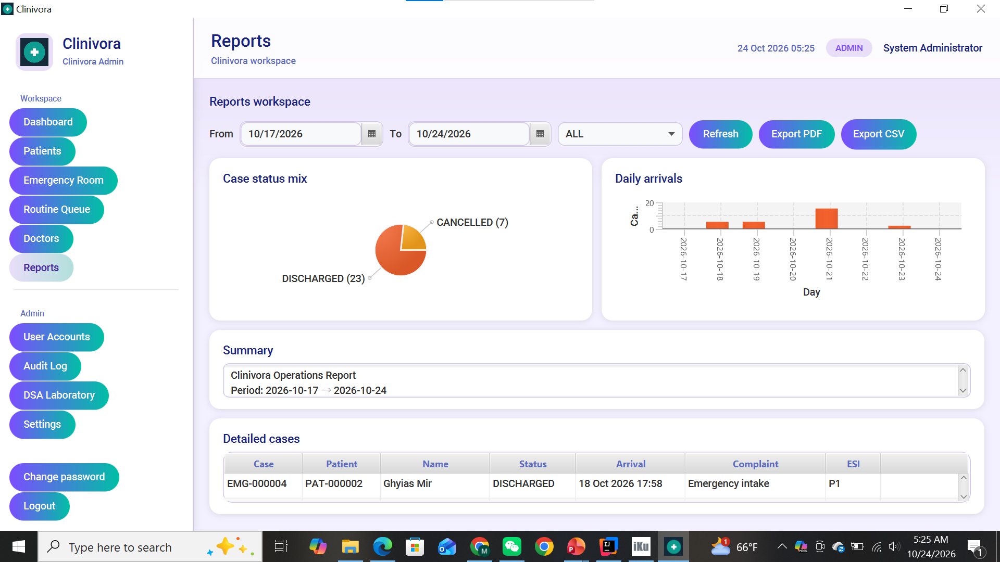

# Clinivora
Clinivora is a Java-based healthcare management application designed to organize clinical information and streamline healthcare-related workflows. This project demonstrates Java programming concepts and software development practices to provide a structured and user-friendly solution.## Project Overview

For more details about Clinivora's features, technologies, permissions, and setup instructions, see the [PROJECT_OVERVIEW.md](PROJECT_OVERVIEW.md) file.
## Screenshots

### Login

### Dashboard

### Emergency Room

### Reports

